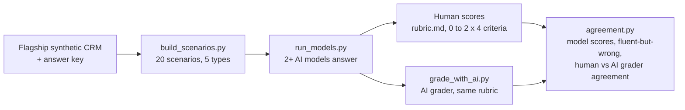

# Forecast Reasoning Eval

**Can you trust an AI's explanation of your forecast?** This repo tests whether AI models explain a revenue forecast correctly, not just fluently. Every scenario is built on a synthetic CRM with a planted answer key, so every answer can be checked.

> Status: **in build.** Scenarios, answer keys, rubric, model runner, AI grader and agreement maths are done and tested. Model answers and my human scores are the next step; results will be published here when they are in.

> All data is synthetic, generated by [revops-forecast-integrity](https://github.com/FeyisayoDaisi/revops-forecast-integrity). Nothing here comes from any client, platform or contract work: the scenarios and the rubric are my own.

**Recruiter takeaway:** I can design an evaluation that separates a fluent AI answer from a correct one, on the business problems revenue teams actually ask AI about.

## The problem

Revenue teams now ask AI tools to explain why the forecast dropped, which deals to inspect before the call, and whether a rep's commit is real. The answers read well. Nobody checks whether they are right. A confident wrong explanation is worse than none, because a busy CRO will act on it.

## How it works



1. **Scenarios** (`build_scenarios.py`, output in `scenarios/`). Twenty questions, four of each type, each with the data a model needs and a checkable answer in `answer_key.jsonl`:

| Type | The question | What the key holds |
| --- | --- | --- |
| `forecast_change` | By how much did in-quarter pipeline move this week, and what drove it? | total change and the biggest driver |
| `inspect_three` | Which three deals would you inspect before the call? | the deals with planted problems, ranked by amount |
| `commit_credible` | Is this rep's commit credible? | what the commit really closed at |
| `stage_check` | Is this deal's stage and category right? | abandoned, mis-staged, stalled or no issue |
| `weighted_math` | What is the stage-weighted value of these deals? | the exact total |

2. **Rubric** (`rubric.md`). Numerical correctness, root cause, actionability and risk awareness, each scored 0, 1 or 2 against the answer key. Answers that read well but score 0 on numbers or root cause are logged as **fluent but wrong**.
3. **Models** (`run_models.py`). Each scenario goes to two or more models, one call each, temperature 0.
4. **Human scoring** (`make_score_sheet.py`). I score every answer in `scores/human_scores.csv`.
5. **AI grader** (`grade_with_ai.py`). An AI grader scores the same answers with the same rubric and key.
6. **Agreement** (`agreement.py`). Average score per model and criterion, the fluent-but-wrong list, and exact agreement, within-one agreement and Cohen's kappa between my scores and the AI grader's. The question it answers: could a team safely let an AI grade its AI?

## Stack

| Tool | Job | Cost |
| --- | --- | --- |
| Python with pandas, tabulate | Scenarios, scoring, agreement | Free |
| Claude API | Model under test and AI grader | Pay per use, about $1 for a full run |
| OpenAI API | Second model under test | Pay per use, about $1 |

## Setup

```bash
git clone https://github.com/FeyisayoDaisi/revops-forecast-reasoning-eval.git
git clone https://github.com/FeyisayoDaisi/revops-forecast-integrity.git   # only needed to rebuild scenarios
cd revops-forecast-reasoning-eval
pip install -r requirements.txt
export ANTHROPIC_API_KEY=...  OPENAI_API_KEY=...
```

## Usage

```bash
python build_scenarios.py --flagship ../revops-forecast-integrity   # optional: scenarios are already committed
python run_models.py --models claude:claude-sonnet-5-5 openai:gpt-5
python make_score_sheet.py        # then fill in scores/human_scores.csv
python grade_with_ai.py
python agreement.py
```

| Output | What is in it |
| --- | --- |
| `answers/<model>.jsonl` | id, model, answer |
| `scores/human_scores.csv` | id, model, the four criteria (0 to 2), fluent_but_wrong, note |
| `scores/ai_grader_scores.csv` | the same columns, from the AI grader |
| `results/summary.csv` | average score per model per criterion |
| `results/agreement.csv` | criterion, answers, exact agreement, within one, Cohen's kappa |
| `results/fluent_but_wrong.csv` | the answers that read well and were wrong |

## Results

Pending: the model runs and my scoring. This section will hold the scored comparison table, three fluent-but-wrong examples and the human versus AI grader agreement rate.

## Design notes

- **Answer keys come from the data, not from opinion.** The flagship generator planted every problem, so "which deals should you inspect" has a right answer.
- **The grader sees the key, the model does not.** Models get only the question and the data.
- **Scores are 0 to 2, not 1 to 10.** A three-point scale is faster to apply consistently and easier to agree on.
- **Agreement is measured with Cohen's kappa,** which corrects for the agreement two graders would reach by chance.
- **Restartable runs.** `run_models.py` skips scenarios already answered, so a failed run picks up where it stopped.

## Troubleshooting

| Error | Cause | Fix |
| --- | --- | --- |
| The first `forecast_change` scenario had a $0 change | Week 5 to week 6 was a quiet week in that quarter | The builder now picks the busiest week-on-week move between weeks 3 and 10 |

## Privacy and compliance

No personal data: all names are invented. Scenario text is sent to the model providers' APIs. Nothing from any client, platform or contract engagement is used: no end clients, task scenarios, models or rubrics from that work.

## Limitations

- Twenty scenarios is enough to show patterns, not to rank models with confidence.
- One human grader. A second grader would let me report human-to-human agreement as the ceiling.
- The scenarios are built on synthetic data, which is tidier than a real CRM.

## What I would add in production

Run the eval every time a team changes its AI model or prompt, and block the change if numerical correctness drops.

Built by **Feyisayo Daisi**, Revenue Systems Architect. [LinkedIn](https://www.linkedin.com/in/feyisayo-daisi-1ba481191)
